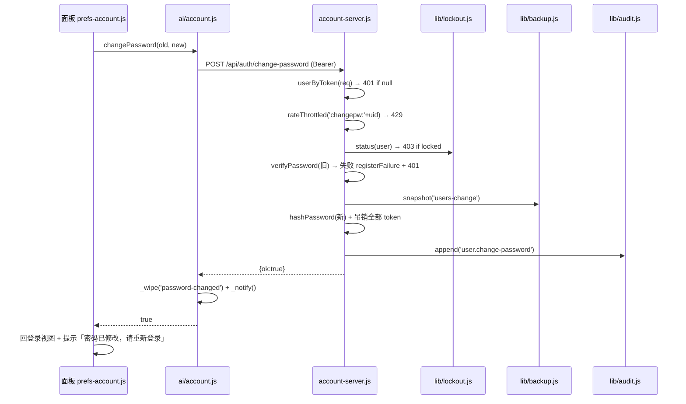
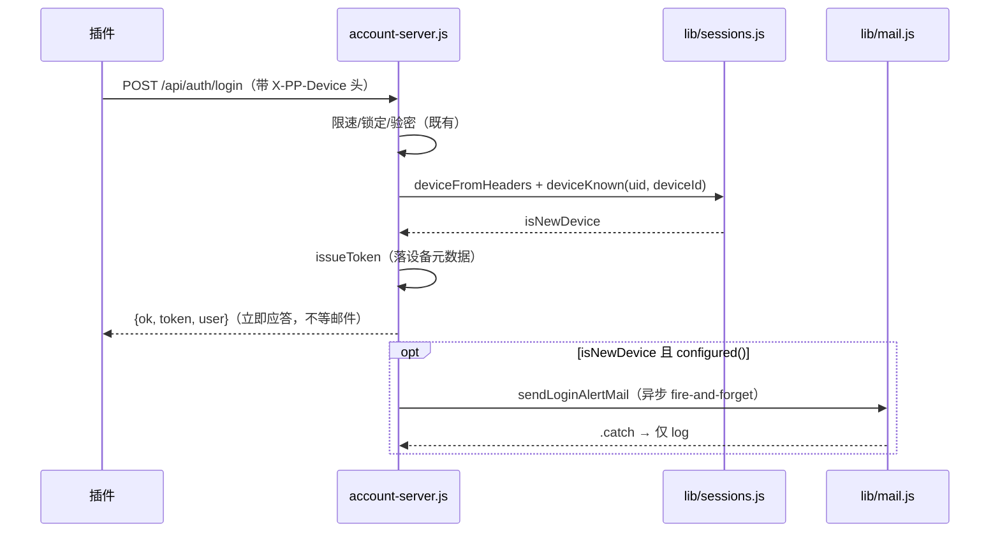
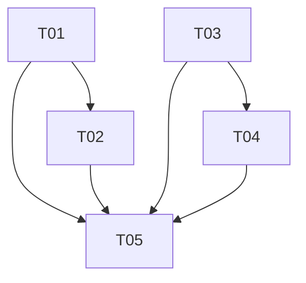

# 账号与会员增强 · 增量架构设计

- **日期**：2026-10-23
- **作者**：高见远（架构师）
- **上游**：`docs/prd/2026-10-23-账号与会员增强-PRD.md`（许清楚，已评审通过）
- **状态**：接口契约冻结，可作为服务端 / 面板两位工程师并行开发的唯一事实源
- **Language**：中文

> 本文档所有字段命名为**契约**：服务端工程师与面板工程师都按此文实现，
> 任何一方需要改名先回到本文档修订，再改代码。

---

## 1. 实现途径（技术难点与选型）

**无新技术选型**——这是对既有零依赖系统的增量扩展，全部复用现有框架：

| 难点 | 决策 | 依据（代码证据） |
|---|---|---|
| 改密码要踢全部会话 | 复用 `/api/auth/reset` 的「遍历 tokens 按 userId 删除」循环（account-server.js:2826） | 不发明第二种吊销路径 |
| 改密码防旧密码爆破 | 复用 `lib/lockout.js` 失败计数/阶梯锁定（与 login 同款） | PRD 验收①明确要求计入登录锁定 |
| 新设备判定 | `sessions.deviceFromHeaders(req.headers)` 已有；新增 `sessions.deviceKnown(doc, userId, deviceId)` 扫该用户**未过期**令牌里是否已有同 deviceId | 令牌表是唯一持久化会话事实源，不新增存储 |
| 邮件发送 | `lib/mail.js` 已有 `send()` 与模板惯例（sendVerifyMail/sendResetMail），新增 `sendLoginAlertMail()` | `configured()=false` 时自然静默降级 |
| 订单/流水列表 | 纯读接口：`lib/membership.js` 加 `ordersOfUser + orderListOut`（**不含 pay 块/交易号**），`lib/balance.js` 加 `ledgerForClient + ledgerLabel` | 复用现有 `balance.ledger` / `membership.json.orders`，不改数据形状 |
| 文案下发 | `/api/plans` 组装时并上 `signupGrant`/`proMonthlyGrant` 两块；plans 缓存面板已有（`mbPlans`） | 单一真源 = pricing.json 的 balance 块 + membership.json 的 plans.Pro.monthlyGrantMicro |
| 面板折叠区 | 复用「链接按钮 toggle + display:none 容器」惯例（`pp-mb-compare-toggle` / `pp-bal-recharge` 同款），不引入新 UI 框架 | 测试迷你 DOM 只支持 getElementById / 单类选择器，新代码同样只用这两样 |
| R8 联动展开 | `window.PapilotPrefsFold.open("channels")`（prefs-fold.js 已暴露的全局 API）+ `scrollIntoView` | 直写 classList 不写 prefsFoldOpen 是已知坑，必须走 open() |

## 2. 接口契约（唯一事实源）

通用约定：**全部应答 JSON 顶层带 `ok:boolean`**；错误体 `{ok:false, error:"中文可读文案"}`；
金额一律微元整数（`*Micro`），需要展示的金额文案由服务端附带（前端零换算）。

### 2.1 R1 · POST /api/auth/change-password（新增，Bearer）

```
请求头: Authorization: Bearer <token>
请求体: { "oldPassword": "string", "newPassword": "string" }
```

| 状态 | 条件 | 应答体 |
|---|---|---|
| 200 | 成功 | `{ok:true}`（此时**全部会话含当前已被吊销**，客户端必须本地清 session 回登录视图） |
| 400 | 缺字段 / `newPassword` 长度 < 8（与注册同规则） | `{ok:false, error:"新密码至少 8 位"}` |
| 401 | 旧密码错误（计入 `lockout.registerFailure`，与登录失败共享计数与阶梯锁定） | `{ok:false, error:"旧密码不正确"}` |
| 403 | 账号处于锁定期（即使旧密码正确也拒绝，同 login 语义） | `{ok:false, code:"account_locked", lockUntil, remainMinutes, error}` |
| 429 | 限速 | `{ok:false, error:"操作过于频繁，请稍后再试"}` |

**限速档位**：`rateThrottled('changepw:' + user.id, LOGIN_MAX, LOGIN_WINDOW_MS)`（每账号每分钟 10 次，与登录同常量）。

**服务端处理顺序（硬顺序，与 reset 同构）**：
`rateThrottled` → `lockout.status` → `verifyPassword(旧)`（失败→`lockout.registerFailure`+save+401）→ 强度校验 → `snapshot('users-change', {note:'修改密码：'+email})` → 换 salt/hash（**复用 account-server.js:645 的 `hashPassword`**）→ `lockout.reset` → 吊销该用户全部 token（含当前）→ `usersStore.save()` → `auditLog(req, 'user.change-password', {target: email, note:'自助修改密码，全部会话已吊销'})` → 200。

**审计中文名同步两处**：`server/lib/audit.js` 的 `ACTIONS` 加 `'user.change-password': '修改密码'`；`scripts/launcher.ps1` 的 `Get-AuditText` 加同款映射。审计体**不含**密码明文/哈希（`redact()` 的 SECRET_KEY 正则已覆盖 password/hash/salt 键名，after 里不要放这些字段）。

### 2.2 R2 · GET /api/plans（修改，公开接口）

响应新增两个顶层块（**始终下发**，不缺省）：

```json
{
  "signupGrant": {
    "amountMicro": 6000000,
    "validDays": 30,
    "scopeNote": "仅限基础模型"
  },
  "proMonthlyGrant": { "amountMicro": 20000000 }
}
```

- `signupGrant.amountMicro`：读 `balance.cfgOf(pricingStore.data).signupGrantMicro`；**配置为 0 时照样下发 0**（客户端按 0 隐藏「注册赠送」字样），不下发 null。
- `signupGrant.validDays`：`signupValidDays`；`0` = 永久有效（客户端渲染「永久有效」，不显示「0 天」）。
- `signupGrant.scopeNote`：固定字符串 `"仅限基础模型"`（与 R6 对比表口径一致的唯一真源）。
- `proMonthlyGrant.amountMicro`：`membership.planOf(doc, 'Pro').monthlyGrantMicro || 0`。
- 新增 helper：`balance.signupGrantForClient(cfg)`（lib/balance.js）、`membership.proMonthlyGrantOf(doc)`（lib/membership.js），路由只做拼装。

### 2.3 R4 · GET /api/orders?limit=N（新增，Bearer）

```
GET /api/orders            → 默认近 10 条
GET /api/orders?limit=50   → limit 钳制到 [1, 50]
```

```json
{ "ok": true,
  "orders": [{
    "id": "ord-xxx", "kind": "plan|credit",
    "plan": "Pro|null", "planName": "专业版|AI 额度充值",
    "months": 1, "perpetual": false, "cycleName": "按月",
    "status": "pending|claimed|fulfilled|cancelled|expired",
    "amountCents": 2500, "amountText": "¥25.00",
    "createdAt": "ISO8601", "note": ""
  }],
  "count": 1 }
```

- **仅本人订单**（`o.userId === user.id`），按 `createdAt` **倒序**。
- **绝不包含**：`pay` 块（收款码/收款账户）、`outTradeNo`、`tradeNo`、`payChannel`、优惠券内部 id。用新函数 `membership.orderListOut(doc, o)` 白名单序列化——**禁止复用 `orderOut`**（它带 pay 块）。
- `status` 原始枚举下发；中文映射在客户端（待支付/待核销/已入账/已取消/已过期，未知原样显示）。
- **限速**：`rateThrottled('orders-list:' + user.id, PAY_QUERY_MAX, LOGIN_WINDOW_MS)`（每账号每分钟 12 次）。读操作**不审计**（同 /api/sessions GET 惯例）。
- 路由位置：现有鉴权块内、`const om = url.match(...)` **之前**加 `method==='GET' && url==='/api/orders'` 分支（该 URL 已在守卫名单内）。

### 2.4 R5 · GET /api/balance/ledger?limit=N（新增，Bearer）

```
GET /api/balance/ledger            → 默认近 20 条
GET /api/balance/ledger?limit=50   → limit 钳制到 [1, 50]
```

```json
{ "ok": true,
  "entries": [{
    "at": "ISO8601",
    "delta": -2100,
    "kind": "consume",
    "label": "AI 调用 gpt-5",
    "deltaText": "−¥0.0021"
  }] }
```

- **仅本人流水**，新的在前（`ledger.slice(-limit).reverse()`）。
- `delta`：有符号微元（收入为正、消费为负）。
- `deltaText`：服务端格式化带符号文案，正数前缀 `+`、负数前缀 `−`（沿用 discountText 的 U+2212 惯例），前端零换算。
- `label`：服务端生成（PRD Q6），`balance.ledgerLabel(entry)` 映射：

  | kind | label |
  |---|---|
  | consume | `entry.reason`（网关写的是 `'AI 调用 ' + 模型名`），空则 `'AI 调用'` |
  | signup | `注册赠送` |
  | recharge | `额度充值` |
  | adjust | `entry.reason`（如「管理员充值/修正」），空则 `管理员调整` |
  | grant-expire | `注册赠送额度到期回收` |
  | plan-grant | `订阅额度发放` |
  | plan-expire | `订阅额度到期回收` |
  | 其他/未知 | `String(kind)` 原文（验收④兜底） |

- **限速**：`rateThrottled('ledger:' + user.id, PAY_QUERY_MAX, LOGIN_WINDOW_MS)`；读操作不审计。
- **路由守卫名单**（account-server.js:2927 的 if 条件）追加 `url === '/api/balance/ledger'`。
- 新 helper：`balance.ledgerForClient(user, {limit})`（内部走 `sweep(ensure(user))`，只读不写盘——**读路径不调 save**）。

### 2.5 R7 · POST /api/auth/login 增强（无契约变更，纯服务端行为）

成功分支内、`issueToken` **之前**判定新设备：

```js
const device = sessions.deviceFromHeaders(req.headers);
const isNewDevice = !!(device && device.deviceId)
  && !sessions.deviceKnown(usersStore.data, user.id, device.deviceId);
```

- `sessions.deviceKnown(doc, userId, deviceId)`（**新增**，lib/sessions.js）：扫该用户**未过期**令牌，存在 `rec.deviceId === deviceId` 即 true。无 deviceId（旧客户端）→ 不判定、**不发信**（无法去重）。
- `isNewDevice && mail.configured()` → **异步** `mail.sendLoginAlertMail(email, {...})`，`.catch` 只 log，**绝不 await 进响应路径**；发信失败不影响登录、不产生 5xx。
- 新模板 `mail.sendLoginAlertMail(to, { at, deviceName, ipMasked })`：主题 `【Papilot】新设备登录提醒`；正文含时间、设备名（`deviceLabel || platform || '未上报名称的设备'`）、打码 IP（`sessions.maskIp`，**完整 IP 不进邮件**）、指引「如果不是你本人，请立即在 设置 → 账号与会员 中修改密码（会踢掉全部登录设备）」。
- 同设备去重靠 deviceKnown：令牌 30 天有效期内同 deviceId 重登不再发；令牌过期后同设备重登会再发一次（可接受，视为新的登录事件）。

## 3. 数据结构

**不新增任何存储格式**（PRD 硬约束），全部复用：

```
users.json   user.balance.ledger[]  {at, delta, kind, reason, refId, grantedAfter, planAfter, paidAfter}
             user.membership        {plan, months, perpetual, activatedAt, expiresAt, source, refId, history[]}
             user.membership.history[]  {plan, months, perpetual, at, source, refId, note}   ← R3 渲染源
             tokens{key}            {userId, expiresAt, sid, createdAt, createdIp, lastSeenAt, lastSeenIp, deviceId, deviceLabel, platform, zoteroVersion}
membership.json  orders[]          {id, userId, kind, plan, months, perpetual, cycle, status, amountCents, baseCents, tailCents, createdAt, updatedAt, note, ...}
pricing.json   balance             {signupGrantMicro, signupValidDays, enforce, minBalanceMicro, rechargeOptions}
```

**⚠️ 设计澄清（PRD 与实际数据形状的偏差）**：PRD R3 说 history 条目含 `activatedAt/expiresAt`，
实际落库字段是 `at`（开通时间），**没有逐条 expiresAt**。决策：面板每行渲染
「来源中文 + 开通时间（`at`）+ 套餐/时长（`plan` 名 + `months` 个月 / 永久）」，不显示逐条到期时间
（要补该字段属于改存储形状，超出本批次范围）。
source 中文映射：`order`→购买、`code`→激活码、`admin`→管理员开通、`manual`→管理员赠送、
`legacy`→历史迁移、未知→原样显示（验收②）。

## 4. 降级矩阵

| 组合 | 行为 |
|---|---|
| 新面板 × 旧服务端 · R1 | `POST /api/auth/change-password` 404 → account.js 的 `changePassword()` 把错误标 `err.unsupported=true` → 面板隐藏「修改密码」按钮与表单，msg 提示「服务端版本过旧，暂不支持在线改密码」 |
| 新面板 × 旧服务端 · R2 | plans 应答无 `signupGrant` 块 → account.js `plans()` 透传 `null` → **三处 UI 全部回退现有硬编码文案**（¥6/30 天/¥20），不空白不报错 |
| 新面板 × 旧服务端 · R3 | `membership.history` 缺失或空 → 折叠区整块隐藏（纯前端读已有字段） |
| 新面板 × 旧服务端 · R4 | `GET /api/orders` 404 → `ordersList()` 返回 `null` → 「我的订单」折叠区整块隐藏 |
| 新面板 × 旧服务端 · R5 | `GET /api/balance/ledger` 404 → `balanceLedger()` 返回 `null` → 折叠区整块隐藏 |
| 旧面板 × 新服务端 | 全部新增字段/路由向后兼容（新增顶层键、新增 URL），旧面板无影响 |
| R7 | 纯服务端；`PP_RESEND_KEY` 未配置即自然降级为不发 |

## 5. 关键调用流程

### 5.1 修改密码（R1）



### 5.2 新设备登录邮件（R7）



## 6. 文件清单与归属（写冲突隔离）

| 文件 | 归属 | 涉及需求 |
|---|---|---|
| `server/account-server.js` | **服务端工程师** | R1 路由、R2 plans 拼装、R4/R5 路由、R7 login 分支 |
| `server/lib/audit.js` | 服务端工程师 | R1 ACTIONS 中文名 |
| `server/lib/mail.js` | 服务端工程师 | R7 sendLoginAlertMail |
| `server/lib/sessions.js` | 服务端工程师 | R7 deviceKnown |
| `server/lib/balance.js` | 服务端工程师 | R2 signupGrantForClient、R5 ledgerForClient/ledgerLabel |
| `server/lib/membership.js` | 服务端工程师 | R2 proMonthlyGrantOf、R4 ordersOfUser/orderListOut |
| `scripts/launcher.ps1` | 服务端工程师 | R1 Get-AuditText 中文名（UTF-8+BOM 保持） |
| `test/change-password.test.js`（新增） | 服务端工程师 | R1 |
| `test/sessions.test.js`（补断言） | 服务端工程师 | R7 |
| `test/balance-ledger.test.js`（新增） | 服务端工程师 | R5 |
| `test/membership.test.js`（补断言） | 服务端工程师 | R4 |
| `test/balance.test.js`（补断言） | 服务端工程师 | R2 /api/plans 块 |
| `chrome/content/scripts/ai/account.js` | **面板工程师** | R1 changePassword、R4 ordersList、R5 balanceLedger、R2 plans 透传 |
| `chrome/content/prefs.xhtml` | **面板工程师** | R1 表单骨架、R2 去硬编码（id 化）、R3/R4/R5 折叠骨架、R6 对比表行、R8 按钮 |
| `chrome/content/prefs-account.js` | 面板工程师 | 全部渲染逻辑 |
| `chrome/content/prefs.css` | 面板工程师 | R3/R4/R5 折叠区样式（.pp- 前缀） |
| `test/membership-panel.test.js`（补断言） | 面板工程师 | R3/R6/R8 面板渲染断言 |
| `scripts/check-wiring.py` | **面板工程师**（T05 集中收口，避免与服务端并行期互相踩） | 全部新增路由/控件/审计名的静态断言 |

**共享纪律**：`account-server.js` 与 `chrome/*` 分别独占，零交集；`check-wiring.py` 只在 T05 由面板工程师一次性补断言（此时服务端代码已落盘，断言照抄路由字符串）。两侧唯一耦合 = 本文 §2 契约。

### 面板新增元素 id 清单（XHTML，全部 `display:none` 起步）

| 需求 | id |
|---|---|
| R1 | `pp-cpw-toggle`（按钮）、`pp-cpw-form`（表单块）、`pp-cpw-old`、`pp-cpw-new`、`pp-cpw-new2`、`pp-cpw-submit`、`pp-cpw-cancel`、`pp-cpw-msg` |
| R2 | `pp-login-grant-hint`（L66 hint 整句 id 化）、`pp-cmp-grant-free`、`pp-cmp-grant-pro`（对比表 AI 额度行两格） |
| R3 | `pp-mb-history-toggle`、`pp-mb-history`（容器，内列表 JS 生成） |
| R4 | `pp-orders-toggle`、`pp-orders-block`、`pp-orders-list`、`pp-orders-msg` |
| R5 | `pp-ledger-toggle`、`pp-ledger-block`、`pp-ledger-list` |
| R8 | `pp-bal-open-channels`（余额不足 note 旁，仅不足分支显示） |

XHTML 纪律：新增文案直接写中文，**禁止**未转义 `&` `<` `>` 与未定义实体；动态文本一律 JS `textContent` 注入。

## 7. 任务列表（派工粒度）

> 两位工程师在契约冻结后**完全并行**；同组内部任务因共享文件而串行。

### 服务端工程师

| ID | 任务 | 文件 | 依赖 | 优先级 |
|---|---|---|---|---|
| T01 | 服务端安全闭环（R1 改密码 + R7 新设备邮件） | server/account-server.js、server/lib/audit.js、server/lib/mail.js、server/lib/sessions.js、scripts/launcher.ps1、test/change-password.test.js（新）、test/sessions.test.js | 无 | P0 |
| T02 | 服务端只读接口（R2 下发 + R4 订单列表 + R5 流水） | server/account-server.js、server/lib/balance.js、server/lib/membership.js、test/balance-ledger.test.js（新）、test/membership.test.js、test/balance.test.js | T01（同文件串行） | P0→P1 |

### 面板工程师

| ID | 任务 | 文件 | 依赖 | 优先级 |
|---|---|---|---|---|
| T03 | 面板契约层 + R1 改密入口 + R2 三处文案渲染 | chrome/content/scripts/ai/account.js、chrome/content/prefs.xhtml、chrome/content/prefs-account.js | 无（按本文 §2 契约即可开工） | P0 |
| T04 | 面板折叠区（R3 会员记录 + R4 我的订单 + R5 扣费明细 + R8 联动按钮） | chrome/content/prefs.xhtml、chrome/content/prefs-account.js、chrome/content/prefs.css、test/membership-panel.test.js | T03（同文件串行） | P1→P2 |
| T05 | R6 对比表口径 + check-wiring.py 静态断言全集 + 门禁收口 | chrome/content/prefs.xhtml、scripts/check-wiring.py（断言：R1 路由+审计名两处、R4/R5 路由、R6 对比表行存在且含 scopeNote 关键词、新增 xhtml id 与 js 引用对账） | T01–T04 | P2 |



**收口纪律（T05）**：`python scripts/preflight.py --fast` 全绿 → 重启生产 :8000（服务端改动必须同轮生效）→ 核对 `/api/health` 版本与新路由应答。

## 8. 测试点清单（QA 断言列表）

风格：手写断言脚本（`ok()/eq()` 计数）、`listen(0)` 回读端口、HTTP 助手**必须 `agent:false`**、时间戳相对 `Date.now()`。

### R1 · test/change-password.test.js
1. 注册+登录 → 改密（旧密错误）→ **401** 且 `failCount` +1（读 users.json 验证）
2. 连续 5 次旧密错误 → 第 5 次起 **403 `account_locked`**（与登录共享锁定）
3. 新密码 7 位 → **400**；新密码与旧密码相同允许（不额外限制）
4. 成功改密 → 旧 token 访问 `/api/auth/me` 立即 **401**（含当前会话被踢）
5. 新密码登录 → 200
6. `audit.log` 存在 `action='user.change-password'` 一条，且**全文不含**新旧密码明文与 hash 值
7. 每分钟超限 → 429
8. `snapshot` 产物出现（备份目录有新快照，或 mock 注入断言）

### R7 · test/sessions.test.js（补）
9. 桩 SMTP（`PP_RESEND_BASE` 指向本地 listen(0) 的桩 HTTP 服务）+ 新 `X-PP-Device` 登录 → 桩收到 1 封，正文含打码 IP（`1.2.3.*` 形态）且**不含**完整 IP
10. 同 deviceId 再次登录 → 桩收件数不变（不重复发）
11. 不带 deviceId 头的登录 → 不发
12. 删除 `PP_RESEND_KEY` → 登录照常 200，无任何发信尝试
13. 桩返回 500 → 登录仍 200（发信失败不阻塞、不 5xx）

### R2 · test/balance.test.js（补）
14. `GET /api/plans` 响应含 `signupGrant{amountMicro,validDays,scopeNote}` 与 `proMonthlyGrant{amountMicro}`
15. 经管理接口把 `signupGrantMicro` 改为 ¥10 后重拉 → `amountMicro=10000000`（免发版生效）
16. `signupValidDays=0` → `validDays===0`（客户端渲染「永久有效」的判定值如实下发）

### R4 · test/membership.test.js（补）
17. 两账号各有订单 → A 的 `GET /api/orders` 不含 B 的订单 id
18. 默认 10 条；`?limit=500` → 钳到 50；倒序（首条 createdAt 最新）
19. 每条**不含** `pay`/`qrImage`/`outTradeNo`/`tradeNo` 键
20. 未带 token → 401；限速触发 429

### R5 · test/balance-ledger.test.js（新）
21. 注册赠送+一次网关消耗后 → entries 含 `signup`（delta>0）与 `consume`（delta<0），条数 ≤ limit
22. `label`：consume 条 = `'AI 调用 xxx'`；手工构造未知 kind → label === kind 原文
23. 账号 A 拿不到 B 的流水；无 token → 401
24. `deltaText` 正负号正确（`+¥6.00` / `−¥…`）

### R3/R6/R8 · test/membership-panel.test.js（补，vm + 迷你 DOM）
25. history 有 N 条（N≤10）→ 展开后行数 === N；source 枚举中文映射各命中；未知 source 原样显示
26. 空 history / 无 history 字段 → `pp-mb-history-toggle` 与容器整块 `display:none`
27. 对比表「注册赠送」行免费版格含「仅限基础模型」；与 `pp-bal-note` 常规态文案关键词一致
28. 余额不足分支渲染时 `pp-bal-open-channels` 出现；点击 → `PapilotPrefsFold.open('channels')` 被调用且目标卡片 scrollIntoView；channels 卡不存在时按钮不渲染
29. plans 缓存无 `signupGrant`（旧服务端桩）→ 三处文案回退硬编码占位，无异常

### R6 · check-wiring.py 断言
30. 删掉对比表「注册赠送」行 → `python scripts/check-wiring.py` 变红
31. `audit.js` 与 `launcher.ps1` 各含 `'user.change-password'` 中文名（缺一即红）

## 9. Anything UNCLEAR（假设与澄清）

1. **history 无逐条 expiresAt**：见 §3。按「开通时间+时长」渲染，不改存储。
2. **R1 的 404 探测策略**：没有独立能力探测接口，采用「首次提交时遇 404 → `err.unsupported` → 隐藏按钮」的惰性降级（首次会闪一次表单，可接受；比常驻轮询探测简单）。
3. **R7 令牌过期后重登会再发一次邮件**（30 天窗口外同设备视为新事件）。不加持久化「已知设备表」——那会新增存储形状，违反约束。
4. **改密后不保留当前会话**（PRD Q1 已拍板踢全部），客户端成功回调里直接 `_wipe` + 回登录视图。
5. **ledger 读路径不落盘**：`sweep` 可能惰性修改内存（到期清零），但读接口不 `save()`（与 /api/auth/me 的 1.9.1 节流口径一致——真有变更由下一写路径落盘）。
6. **版本号**：服务端头注释版本 1.9.2 → 1.10.0（T01 起笔时改）；插件 manifest 版本由发版轮次决定，本设计不指定。
